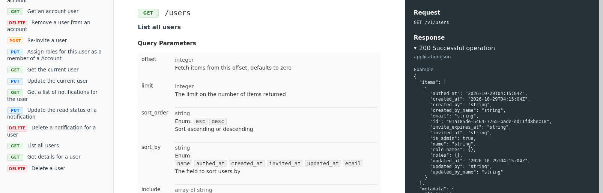

# OpenAPI document generator

Generate HTML from an OpenAPI specification file.

## Goals

- Dead simple
- No Javascript
- Minimal HTML for embedding

## Themes

Just one for now. Feel free to add more.

